# zabbix-pnetlab-monitoring
Network monitoring lab: Zabbix + SNMP on a PNETLab virtual topology.

## Objective
Build a virtual network in PNETLab and monitor it end to end with Zabbix,
including detecting when devices or links fail.

## Topology

The Zabbix server sits outside the lab and reaches every device through a
**single link** to the PNETLab management cloud (Cloud0), attached to R5.
All other devices (R6, SW1, SW2) are polled through R5 using static routes.

| Device | Interface | Address | Role |
|--------|-----------|---------|------|
| R5 | e0/0, e0/1, e0/2 | 192.168.1.254/24, 10.0.0.1/30, 192.168.139.51/24 | Router, attached to Cloud0 |
| R6 | e0/0, e0/1 | 10.0.0.2/30, 192.168.2.254/24 | Router |
| SW1 | Vlan1 | 192.168.1.253/24 | L2 switch, gateway 192.168.1.254 |
| SW2 | Vlan1 | 192.168.2.253/24 | L2 switch, gateway 192.168.2.254 |
| VPC1 | eth0 | 192.168.1.1/24 | End host on SW1, gateway 192.168.1.254 |
| VPC2 | eth0 | 192.168.2.1/24 | End host on SW2, gateway 192.168.2.254 |
| Zabbix appliance | eth0 | 192.168.139.129/24 | Monitoring server |

## Environment
| Component      | Details                                          |
|----------------|--------------------------------------------------|
| Host OS        | Linux Mint                                       |
| Hypervisor     | VMware Workstation (NAT, vmnet8)                 |
| PNETLab        | Version: 4.2.10                                  |
| Zabbix server  | Zabbix 7.4.15 VMware appliance                   |
| Devices        | Cisco IOL routers and L2 switches, VPCS hosts    |
| Protocol       | SNMPv2c, template "Cisco IOS by SNMP"            |

## Lab Report
[docs/Zabbix-PNETLab-Lab-Report.pdf](docs/Zabbix-PNETLab-Lab-Report-1.pdf)

### Test 1: Interface shutdown on R6

Before the failure injection.

Failure Injection on e0/1
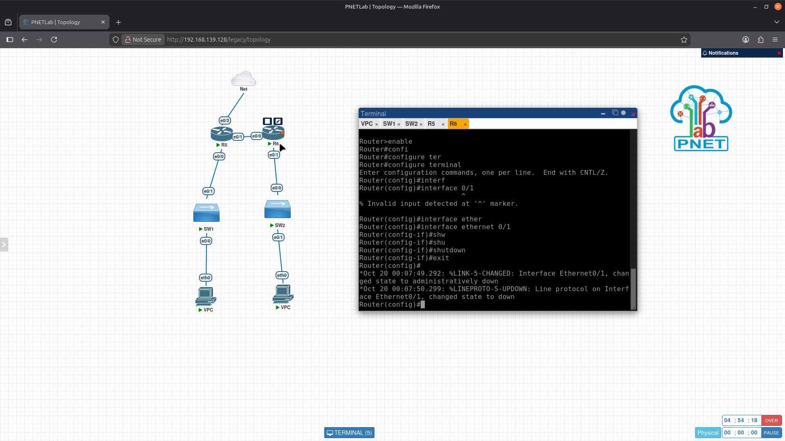

Link Down (Warnings are just normal issues for the IOS images)
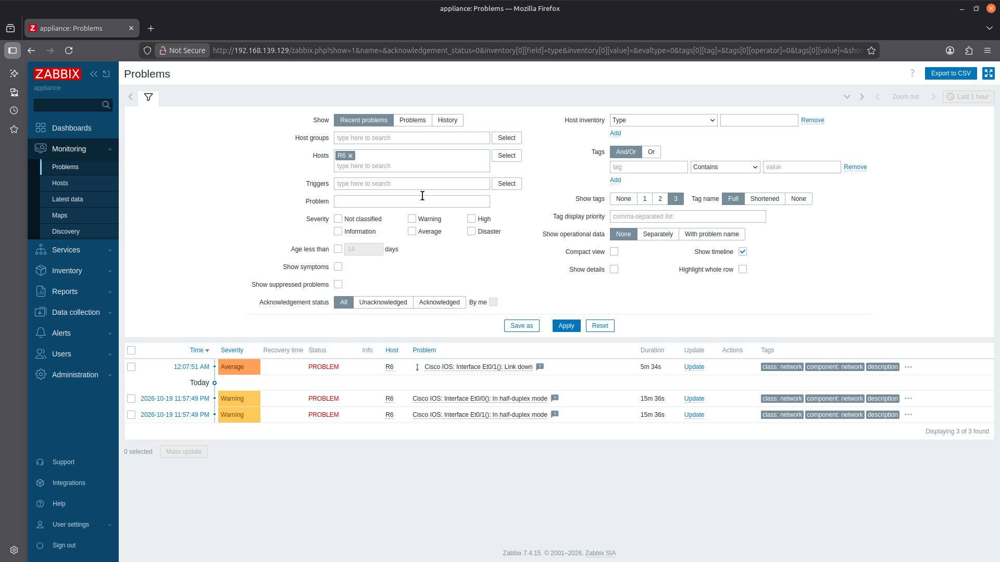

SW1 fails
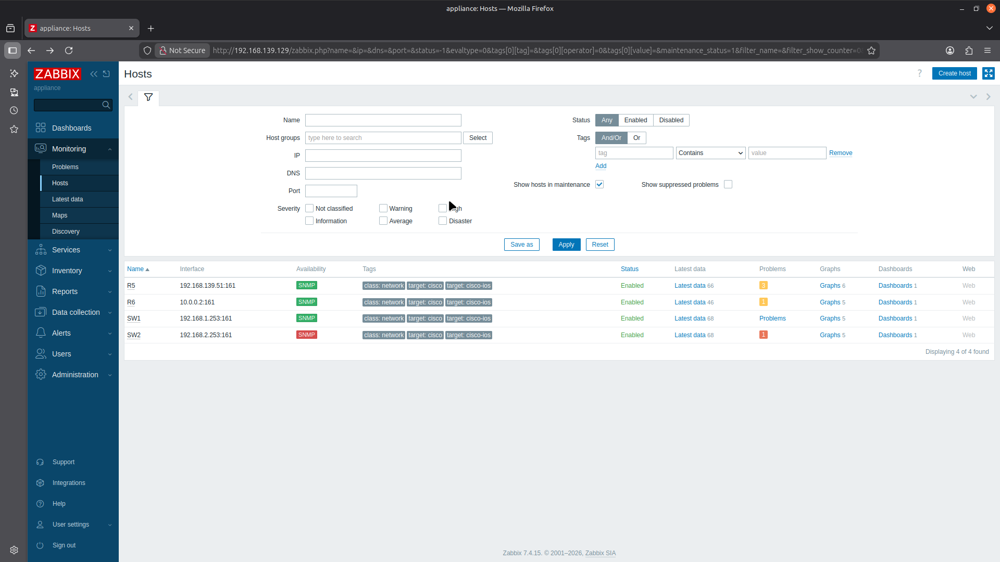

We recover the connection activating e0/1.
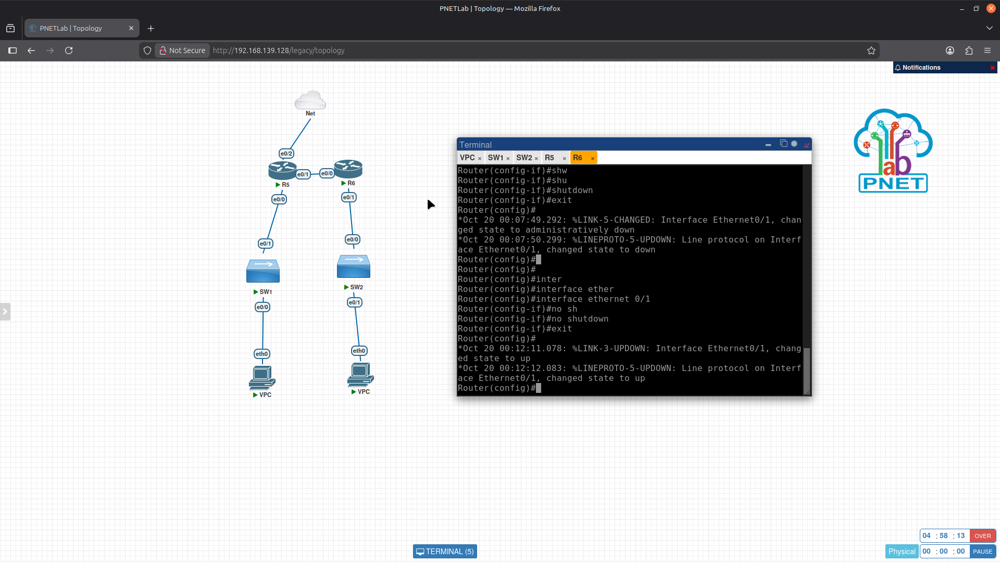

Full recovery.
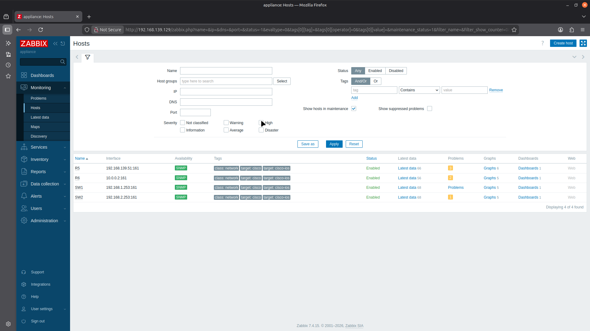

### Test 2: Interface shutdown on R5

Before the failure injection.
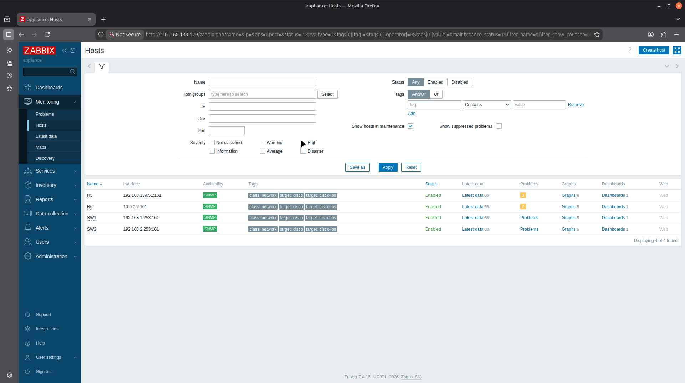

Failure Injection on e0/1.
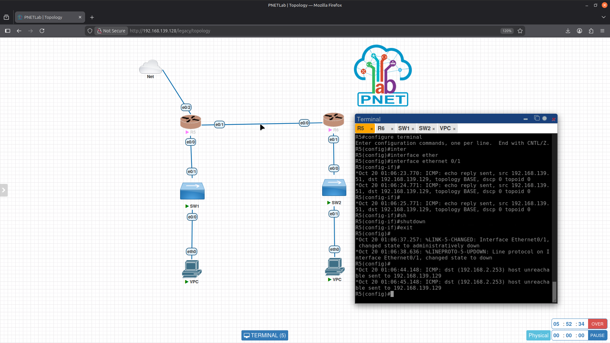

Link Down (Warnings are just normal issues for the IOS images) (we can also see that zabbix informs about the changed name on the router).
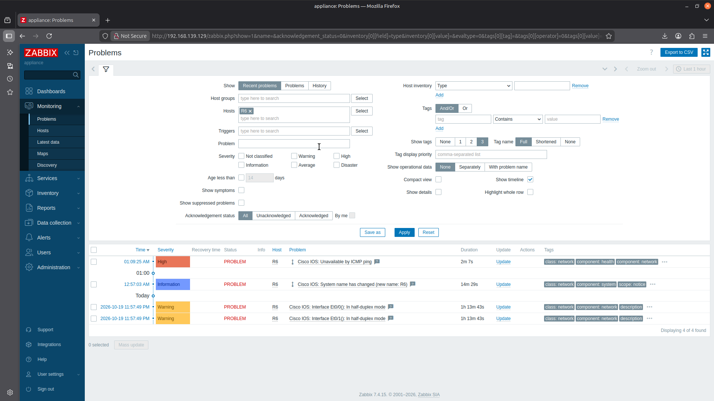

R6 and SW2 fails. 
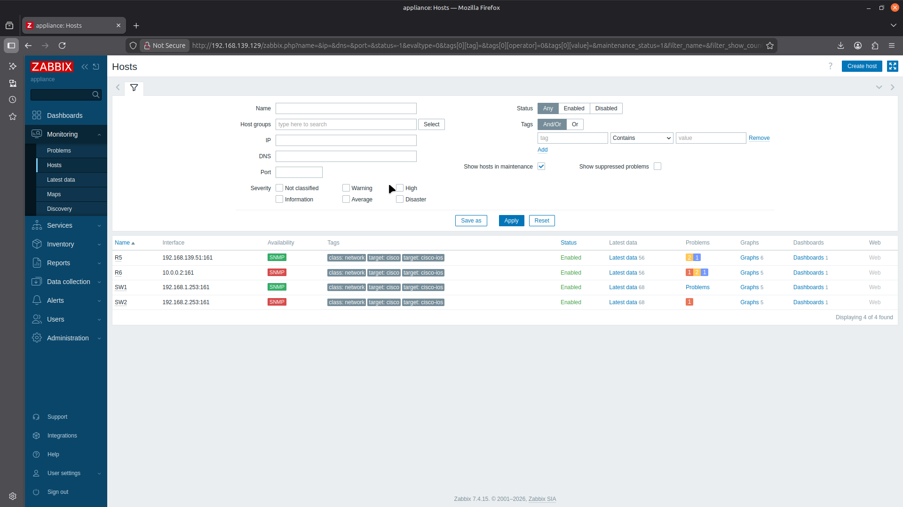

We recover the connection activating e0/1
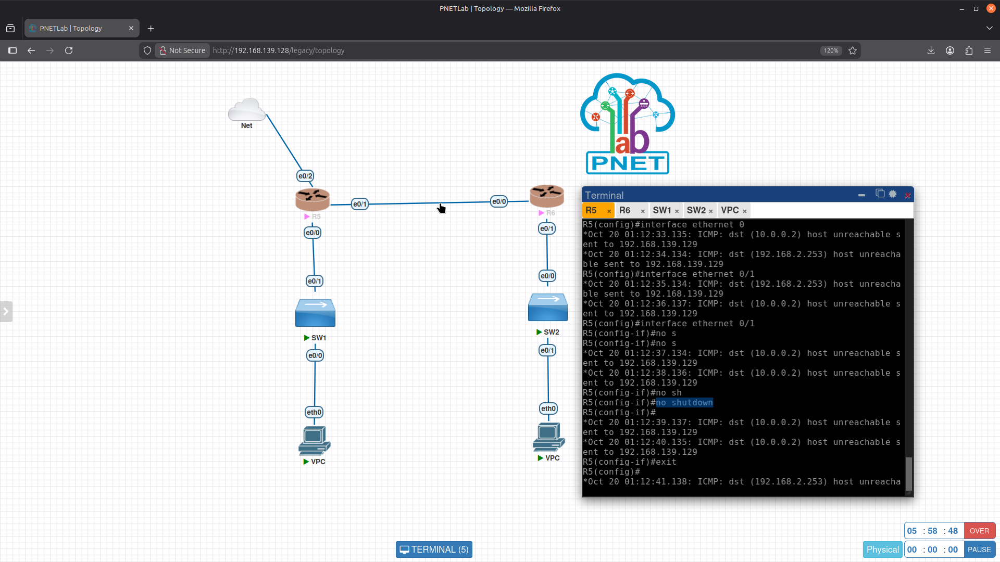

Full recovery.
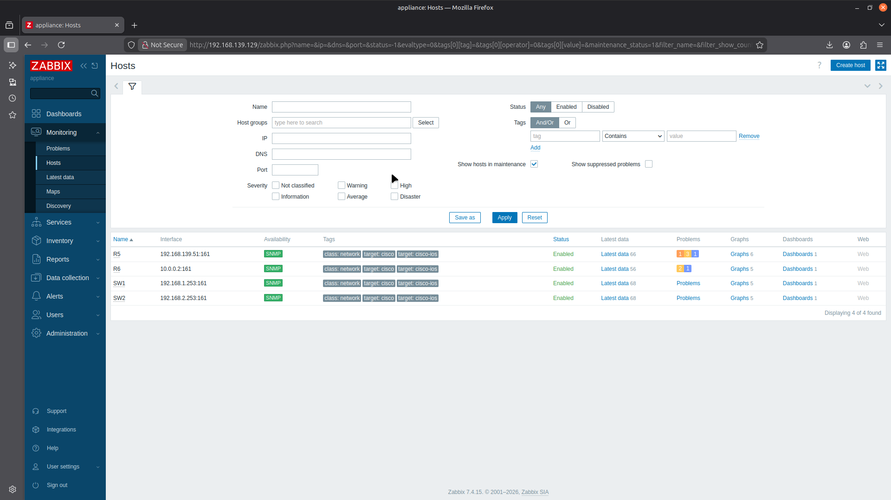

Main problems solved:
- Appliance could not reach routers: VMware promiscuous mode / `/dev/vmnet8` permission
- Switch ignored `ip default-gateway` because IP routing was enabled
- Appliance needed static routes into the lab subnets
- Zabbix database "Connection refused" after an appliance restart

## License
MIT
